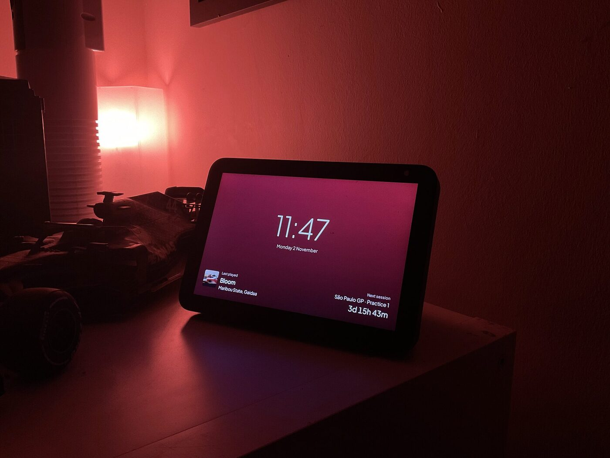
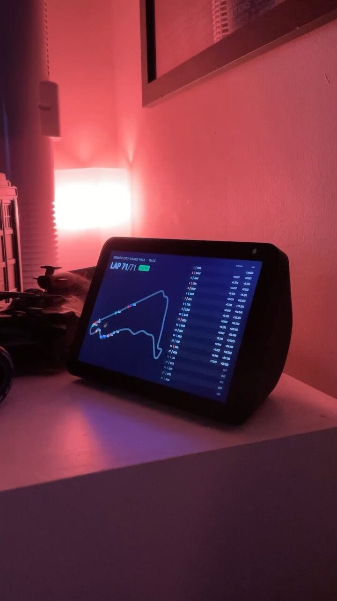
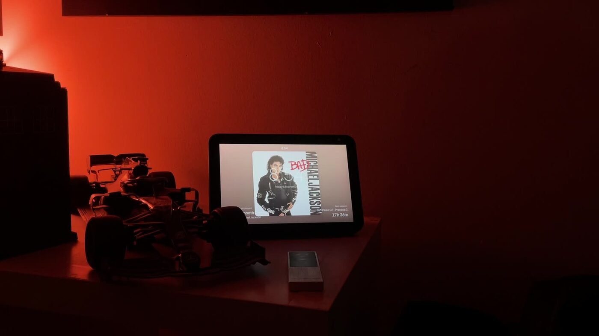

# Echo Cover

A tiny fullscreen Android app for the Echo Show 8 (Gen 2): it shows the album cover of whatever
you're playing on Spotify, with big tap zones either side to go to the previous or next track.
No third-party libraries, no Spotify app needed on the device.

It is a **remote**: audio plays on another Spotify device (phone, speaker, desktop app).
Spotify Premium is required to skip tracks.

> **Status: proof of concept.** This is a working prototype that is still evolving. It does what it
> says on my own hardware, but expect rough edges, hard-coded choices and changes that break
> things between commits. Issues and suggestions are welcome.

## Screenshots

The app on an Echo Show 8, photographed on my shelf.

| Home screen | Live F1 session | Song playing |
| :---: | :---: | :---: |
|  |  |  |

The home screen background takes its colour from the last played song. Between F1 sessions it shows
a countdown to the next one.

## 1. Create a Spotify app (one-time, ~2 minutes)

1. Go to https://developer.spotify.com/dashboard and create an app.
2. Add this **Redirect URI**, exactly: `echocover://callback`
3. Tick **Web API** as the API used.
4. Copy the **Client ID** and paste it into
   `app/src/main/java/com/echocover/Config.kt` (`CLIENT_ID`).

New apps start in Development Mode, which only lets users you've authorised use them. That's
what you want here: your own account only. Under *User Management*, add your Spotify account's
email if it isn't the app owner's. (As of 2026 Development Mode requires the owner to have
Premium and allows up to five users.)

## 2. Build the APK

1. Install Android Studio and open the `EchoCover` folder. Let Gradle sync.
2. Build > Build Bundle(s) / APK(s) > Build APK(s). Output:
   `app/build/outputs/apk/debug/app-debug.apk`

## 3. Install on the Echo Show

```
adb connect <echo-ip>:5555     # or use USB, depending on your Android build
adb install -r app-debug.apk
```

Open **Echo Cover**, tap **Connect Spotify**, log in and approve. If the device has no web
browser, the app falls back to an in-app login page. Spotify may refuse Google/Facebook
sign-in there, so use your Spotify email and password.

## Using it

- Start playing on any of your Spotify devices; the cover appears within a few seconds.
- The background fades to a colour taken from the album art, and cross-fades on each new track.
- Tap the album cover to pause or resume (the cover shrinks slightly while paused).
- Tap the empty area left of the cover for previous, or right of it for next. There are no
  visible buttons.
- A small clock sits above the cover.
- When nothing has been playing for 10 seconds (`PAUSED_CLOCK_AFTER_MS` in `Config.kt`), it fades
  to the home screen, on the last song's colour: the time and date, your last played song from
  Spotify's listening history, and (with the F1 server set up) a countdown to the next F1
  session. If you connected Spotify before the home screen existed, reconnect once (long-press the
  clock, then Connect Spotify) so the app may read your listening history.
- Screens cross-fade into each other (`FADE_MS` in `Config.kt`).
- Long-press the clock to disconnect your account from the device.
- The screen stays on while the app is open.

## Live F1 dashboard

While an F1 session (practice, qualifying, sprint or race) is on, the screen switches to a black
dashboard. It shows the lap count (or time left), track status, the timing tower, and a track map
with a dot for each car. It switches back to the cover or clock about 10 minutes after the
session ends.

The data comes from a small FastF1 server in `f1server/` that runs on another machine, such as an
AWS EC2 instance. Set it up with [f1server/README.md](f1server/README.md), then set
`F1_SERVER` in `Config.kt`. With `F1_SERVER` empty the dashboard is off.

- Long-press the dashboard to go back to the cover for the rest of that session.
- Without an F1 TV account on the server, car positions on the map are estimated from live timing.
  With one, they're exact.

## Notes

- Text is set in Plus Jakarta Sans, bundled in `app/src/main/res/font/` under the SIL Open Font
  License (`licenses/PlusJakartaSans-OFL.txt`). Bundled fonts need Android 8 or later.
- Spotify's "previous" restarts the current track if you're more than a few seconds in.
  Press twice to go back a track.
- To make it the device's home screen, uncomment the HOME/DEFAULT categories in
  `AndroidManifest.xml`.
- Polling interval is `POLL_MS` in `Config.kt` (default 3 seconds).
